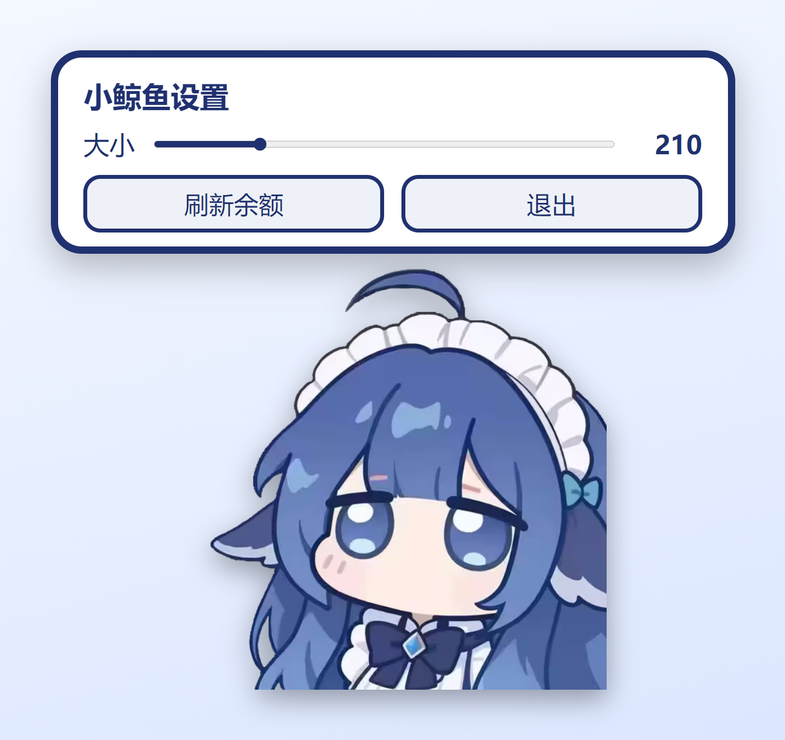

# 🐋 小鲸鱼桌宠 · DeepSeek 余额

<p align="center"></p>

一只常驻桌面的透明小鲸鱼：实时显示 DeepSeek 账户余额和今日消耗，点一下会「rua」一声，拖到屏幕边缘会自己贴上去。
Electron 33 + 原生 HTML/CSS/JS 手写，没有构建步骤，没有框架。

## 功能

| 功能 | 说明 |
| --- | --- |
| 余额显示 | 启动时、每 60 秒、点击鲸鱼时刷新 |
| 今日已用 | 用「余额差分」记账，跨天（北京时间 0 点）清零 |
| 峰谷提示 | 按时间段显示「峰价 / 谷价」 |
| 点击抚摸 | 气泡里播放 rua 动图 + 随机台词，带按下/松开音效（音量随按压时长衔接） |
| 拖拽贴边 | 拖动鲸鱼移动窗口，靠近屏幕边缘 26px 内自动吸附，且不会拖出屏幕 |
| 右键菜单 | 刷新余额、总在最前、开机自启、打开设置、退出 |
| 设置面板 | 150~420 滑块调大小，实时生效并持久化 |
| 点击穿透 | 鲸鱼之外的透明区域不吃鼠标，不影响正常办公 |
| 单实例 | 重复启动不会多开，而是把已有窗口叫出来 |
| 记忆位置 | 位置、大小、开关都存在 `%APPDATA%\whale-pet\pet.json` |

## 截图

<p>
  
  
  
</p>

## 快速开始

需要 Node.js 18+，目前只在 **Windows 10/11** 上验证过。

```bash
git clone https://github.com/GT66691/whale-pet.git
cd whale-pet
npm install
npm start
```

想不弹黑框，双击 `start-whale.vbs`（它会调 `start-whale.bat`，路径全部相对脚本所在目录，项目可以随便搬）。
开机自启在右键菜单里勾一下即可，会往启动目录写一个 `.vbs`。

## 余额是怎么读的

```
GET https://api.deepseek.com/user/balance
Authorization: Bearer <DeepSeek API Key>
```

返回体里取 `balance_infos[0]` 的 `total_balance` 和 `currency`。

**Key 从哪来**（按顺序，见 [main.js](main.js) 的 `claudeKey()`）：

1. 环境变量 `DEEPSEEK_API_KEY`；
2. `~/.claude/settings.json` 里的 `env.ANTHROPIC_AUTH_TOKEN`（或 `ANTHROPIC_API_KEY`）——
   只有当 `env.ANTHROPIC_BASE_URL` 含有 `deepseek` 时才使用，避免拿别的服务的 key 去请求；
3. 都没有时气泡显示「未找到 DeepSeek key」。

Key 只在主进程里读、只用于这一次 HTTPS 请求，不会写给渲染进程，也不会落到磁盘或日志里。

**今日已用**是差分记账，不是官方接口：每次拿到余额就和上一次比较，减少的部分累加到「今日已用」，
增加的部分算充值。所以有一个天然限制：**桌宠没运行时的消费不会计入**。

## 配置与日志

| 文件 | 内容 |
| --- | --- |
| `%APPDATA%\whale-pet\pet.json` | `whale`（大小 150~420）、`x`/`y`（位置）、`alwaysOnTop`、`autostart` |
| `%APPDATA%\whale-pet\account.json` | 今日记账：`day`、`spent`、`recharged`、`last` |
| `%APPDATA%\whale-pet\pet.log` | 运行日志（拖动、吸附、尺寸、请求失败等） |

改坏了直接删掉这两个 json，重启会回到默认状态。

## 目录结构

```
whale-pet/
├─ main.js          # 主进程：窗口、余额请求、拖拽/吸附、点击穿透、菜单、自启
├─ preload.js       # contextBridge 暴露 window.pet.*
├─ index.html       # 面板 / 余额气泡 / rua 气泡 / 鲸鱼
├─ pet.css          # 全部样式，尺寸用 vmin，随窗口等比缩放
├─ pet.js           # 渲染进程：渲染数据、拖拽手势、抚摸音效与动图
├─ assets/          # 鲸鱼图、rua 动图、按压/松开音效、图标
├─ docs/            # README 截图
├─ start-whale.bat  # 无参数启动（相对路径）
└─ start-whale.vbs  # 隐藏控制台启动
```

## 实现上有几个坑，记一下

- **拖动必须用 `setBounds` 而不是 `setPosition`**：只调 `setPosition` 时 Windows 会偶尔把窗口拉长，
  表现为「越往下拖鲸鱼越大」。现在拖拽开始时把尺寸钉死（`winFor(cfg.whale)`），每次移动都用
  `setBounds({x, y, width, height})` 显式带上尺寸。
- **点击穿透靠主进程轮询**：窗口默认 `setIgnoreMouseEvents(true, {forward: true})`，
  渲染进程把鲸鱼/气泡/面板的矩形上报给主进程，主进程每 50ms 拿光标位置和矩形比对再切换穿透状态。
  纯前端方案在穿透状态下收不到鼠标事件，行不通。
- **`.hide` 必须是 `display: none`**：如果只改 `opacity`，隐藏的气泡仍占 flex 高度，会把上方的气泡顶出窗口。
- **吸附算的是「鲸鱼可见矩形」而不是窗口矩形**，窗口里有大片透明留白，否则贴边会差一大截。
- 透明窗口 + `setAlwaysOnTop(true, 'screen-saver')` 才能稳定压在全屏/置顶窗口之上。

## 已知限制

- 「峰价 / 谷价」目前按**工作日 9–12、14–18 点**判断，和 DeepSeek 官方优惠时段（北京时间 00:30–08:30）并不一致，属于待改项。
- 只在 Windows 10/11 + 150% 缩放环境下验证过；macOS/Linux 没有测。
- 没有做 `electron-builder` 打包，目前是源码 + `npm start`。

## 素材来源与许可

代码以 MIT 许可发布，**但 `assets/` 里的形象与音效不在此许可范围内**，详见 [CREDITS.md](CREDITS.md)。
